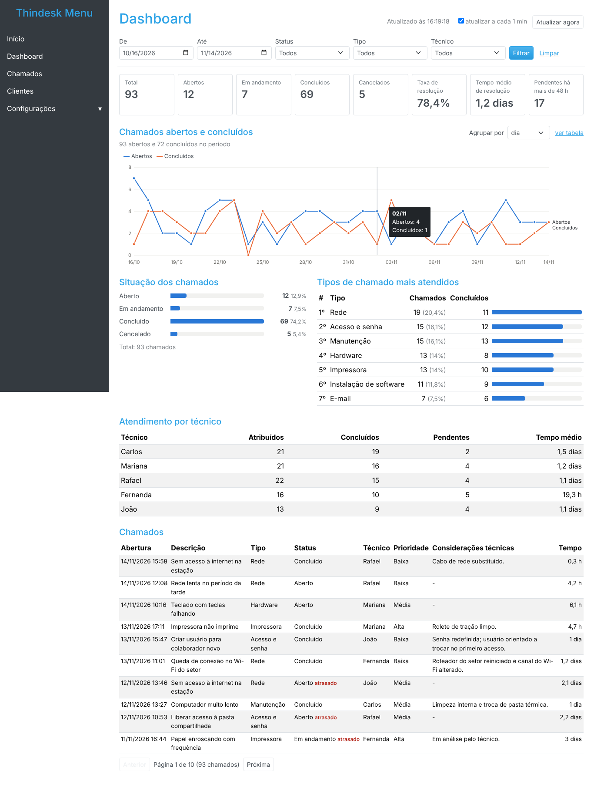

# Thindesk — Dashboard Administrativo

Sistema de chamados técnicos (Spring Boot + MongoDB + Thymeleaf) com um dashboard administrativo alimentado por uma API REST própria.

A documentação completa (requisitos, endpoints, testes e decisões de projeto) está em **[docs/DOCUMENTACAO.md](docs/DOCUMENTACAO.md)**.



## O que tem no dashboard

- Indicadores gerais: total, abertos, em andamento, concluídos, cancelados, taxa de resolução, tempo médio e pendentes fora do prazo
- Gráfico de chamados abertos x concluídos por dia, semana ou mês
- Situação dos chamados e ranking dos tipos mais atendidos
- Atendimento por técnico e lista de chamados com as considerações técnicas
- Filtros por período, status, tipo e técnico, com atualização automática a cada minuto

## Como rodar

Requisitos: JDK 23 e acesso a um MongoDB (o projeto já aponta para o cluster do Atlas em `application.properties`).

```bash
./mvnw spring-boot:run
```

Acesse http://localhost:8080, entre com `admin` / `thindesk` e clique em **Dashboard** no menu.

Variáveis de ambiente opcionais:

| Variável | Para quê |
|---|---|
| `MONGODB_URI` | Usar outro banco, ex.: `mongodb://localhost:27017` |
| `THINDESK_SEED=true` | Inserir ~400 chamados fictícios dos últimos 120 dias (só quando a coleção tem menos de 20 registros) |

Exemplo com banco local e dados de demonstração:

```bash
MONGODB_URI=mongodb://localhost:27017 THINDESK_SEED=true ./mvnw spring-boot:run
```

## API

| Endpoint | Descrição |
|---|---|
| `GET /api/dashboard/resumo` | Indicadores gerais |
| `GET /api/dashboard/periodo` | Abertos e concluídos por dia/semana/mês |
| `GET /api/dashboard/status` | Quantidade por situação |
| `GET /api/dashboard/tipos` | Ranking de tipos |
| `GET /api/dashboard/tecnicos` | Atendimento por técnico |
| `GET /api/dashboard/chamados` | Lista paginada |
| `GET /api/dashboard/filtros` | Opções para os filtros |

Todos aceitam `dataInicio`, `dataFim` (AAAA-MM-DD), `status`, `tipo`, `tecnico` e `prioridade`. Detalhes, exemplos e erros na [documentação](docs/DOCUMENTACAO.md#6-documentação-dos-endpoints). A coleção do Postman está em `docs/thindesk-dashboard.postman_collection.json`.

## Testes

```bash
./mvnw test
```

## Branches (gitflow)

`main` · `develop` · `feature/api-dashboard` · `feature/dashboard-web` · `feature/documentacao` · `release/1.1.0`
