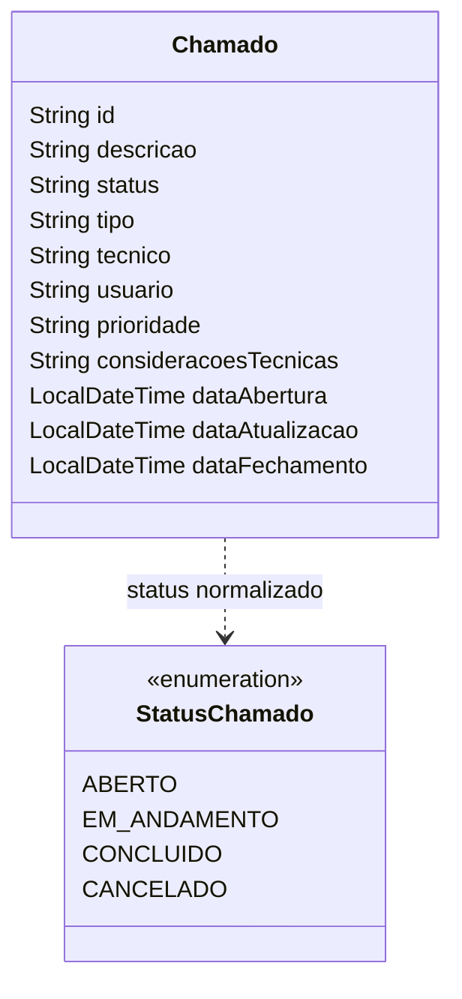
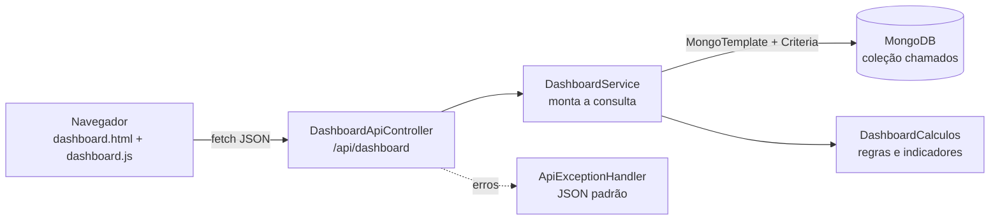
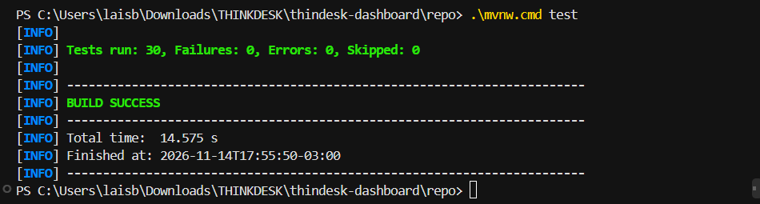

# Dashboard — Thindesk Documentação

## 1. Contexto

O Thindesk é um sistema de chamados técnicos feito em Spring Boot com MongoDB e telas em Thymeleaf. Até aqui ele permitia cadastrar e listar chamados, clientes e horários de atendimento, mas não oferecia nenhuma visão consolidada da operação.

O dashboard faz com que responsável pelos chamados abre uma única tela e vê quantos chamados existem em cada situação, como a demanda e as entregas evoluíram no tempo, quais tipos de problema mais aparecem, como cada técnico está e quais chamados estão parados há tempo demais. Todos os números vêm de uma API REST criada para essa finalidade (`/api/dashboard`).

## 2. Requisitos funcionais

| Código | Requisito | Aplicação no sistema |

| RF01 | Indicadores gerais de chamados técnicos | Endpoint `GET /api/dashboard/resumo` e linha de indicadores no topo da tela: total, abertos, em andamento, concluídos, cancelados, taxa de resolução, tempo médio de resolução e pendentes fora do prazo. |
| RF02 | Análise de chamados atendidos por período (gráficos) | Endpoint `GET /api/dashboard/periodo` e gráfico de linhas com chamados abertos x concluídos, agrupados por dia, semana ou mês. Ao passar o mouse aparece o valor de cada ponto, e há a opção "ver tabela". |
| RF03 | Situação dos chamados | Endpoint `GET /api/dashboard/status` e gráfico de barras com quantidade e percentual por situação (Aberto, Em andamento, Concluído, Cancelado e, se houver, Não informado). |
| RF04 | Tipos de chamados mais atendidos | Endpoint `GET /api/dashboard/tipos` e ranking com posição, tipo, quantidade, percentual e quantos já foram concluídos. |
| RF05 | Filtros de consulta | Todos os endpoints aceitam `dataInicio`, `dataFim`, `status`, `tipo`, `tecnico` e `prioridade`. A tela traz os campos de filtro preenchidos pelo endpoint `GET /api/dashboard/filtros` e guarda os filtros na URL, para que a consulta possa ser compartilhada ou recarregada. |
| RF06 | Integração com a API | A tela não recebe dados do servidor ao ser renderizada; tudo é buscado por `fetch` nos endpoints REST, que consultam o MongoDB. |
| RF07 | Atualização e tratamento de dados | Atualização automática a cada 1 minuto (pode ser desligada) e botão "Atualizar agora", com o horário da última atualização. No back-end, os dados antigos são normalizados ao subir a aplicação (status em formatos diferentes, campo `Tipo` com letra maiúscula, chamados sem data), e o cálculo trata valores vazios como "Não informado" e ignora datas inconsistentes. |


## 3. Requisitos não funcionais

| Código | Requisito |
|---|---|
| RNF01 | **Segurança:** a API e a tela exigem login (Spring Security). Requisições à API sem autenticação recebem `401` em JSON, sem redirecionar para a tela de login. A API aceita a sessão do navegador e também Basic Auth, para testes no Postman/curl. |
| RNF02 | **Desempenho:** os filtros são aplicados na consulta ao MongoDB, e os campos usados nos filtros (`status`, `tipo`, `tecnico`, `dataAbertura`, `dataFechamento`) têm índice. O gráfico por período é limitado a 400 pontos, e a lista de chamados é paginada (máximo de 100 por página). |
| RNF03 | **Usabilidade:** a tela segue o visual das outras páginas do sistema (Bootstrap e o mesmo menu lateral), funciona em telas pequenas e mostra mensagens de erro compreensíveis. |
| RNF04 | **Acessibilidade:** a informação nunca depende só da cor: o gráfico tem legenda e rótulo no fim de cada linha, o atraso é indicado por texto ("atrasado") e o gráfico de período pode ser visto como tabela. |
| RNF05 | **Confiabilidade:** erros seguem um formato JSON único; se o banco estiver indisponível a API responde `503` e a tela mostra o aviso sem travar. |
| RNF06 | **Manutenibilidade:** as regras de cálculo ficam em uma classe sem dependência de Spring ou MongoDB (`DashboardCalculos`), coberta por testes unitários. |
| RNF07 | **Configuração:** o arquivo `application.properties` é local e não deve ser versionado. O exemplo `application.properties.example` define valores não sigilosos; senha, usuário do administrador e URI do banco podem ser configurados por variáveis de ambiente. |
| RNF08 | **Compatibilidade:** Java 23, Spring Boot 3.4 e MongoDB (Atlas ou local). Navegadores atuais (Chrome, Edge, Firefox). Os gráficos são SVG desenhados pelo próprio JavaScript da página, sem biblioteca externa. |

## 4. Modelagem de dados

A coleção `chamados` ganhou campos para permitir a análise por período e as considerações técnicas. Os campos antigos foram mantidos, então os registros já existentes continuam válidos.



| Campo | Novo? | Uso no dashboard |
|---|---|---|
| `status` | não | Situação. Passa a ser gravado sempre como "Aberto", "Em andamento", "Concluído" ou "Cancelado". |
| `tipo` | não | Ranking de tipos e filtro. |
| `tecnico` | não | Desempenho por técnico e filtro. |
| `prioridade` | sim | Filtro e exibição (Baixa, Média, Alta). |
| `consideracoesTecnicas` | sim | Anotação do técnico sobre o atendimento, exibida na lista. |
| `dataAbertura` | sim | Filtro de período, gráfico, tempo em aberto e prazo. |
| `dataAtualizacao` | sim | Registro da última alteração. |
| `dataFechamento` | sim | Gráfico de concluídos e tempo de resolução. |

**Regras de cálculo**

- *Pendentes* = Abertos + Em andamento.
- *Taxa de resolução* = concluídos ÷ (total − cancelados). Os cancelados ficam de fora porque não houve atendimento a concluir.
- *Tempo médio de resolução* = média de `dataFechamento − dataAbertura` dos concluídos. Registros com fechamento anterior à abertura são ignorados.
- *Fora do prazo* = chamado pendente aberto há `thindesk.dashboard.prazo-horas` horas ou mais (padrão 48 h).
- No gráfico por período, o chamado conta como "aberto" no dia em que foi aberto e como "concluído" no dia em que foi fechado. Por isso a consulta desse endpoint traz também os chamados abertos antes do período mas fechados dentro dele.

## 5. Arquitetura



| Camada | Classe | Responsabilidade |
|---|---|---|
| Tela | `templates/dashboard.html`, `static/js/dashboard.js`, `static/css/dashboard.css` | Filtros, chamadas à API, desenho dos gráficos e tabelas, atualização automática. |
| Controller | `DashboardApiController` | Recebe os parâmetros, valida e devolve JSON. |
| Controller | `ApiExceptionHandler` | Converte exceções em respostas 400/404/503/500 com corpo padronizado. |
| Serviço | `DashboardService` | Traduz os filtros em consulta ao MongoDB. |
| Regra de negócio | `DashboardCalculos` | Calcula indicadores, séries, rankings e paginação. |
| DTO | `FiltroDashboard`, `ResumoDTO`, `PeriodoDTO`... | Formato de entrada e saída da API. |
| Configuração | `TratamentoDadosLegados` | Corrige os dados antigos ao iniciar. |
| Configuração | `DadosDemonstracao` | Insere chamados fictícios quando habilitado. |

## 6. Documentação dos endpoints

**URL base:** `http://localhost:8080/api/dashboard`
**Autenticação:** sessão do navegador (após login) ou Basic Auth. O usuário padrão é `admin`; a senha deve ser definida na variável de ambiente `THINDESK_ADMIN_PASSWORD`. O usuário pode ser alterado por `THINDESK_ADMIN_USERNAME`.
**Formato:** todas as respostas são JSON. Datas seguem ISO 8601 (`2026-11-14` e `2026-11-14T10:16:00`).

### 6.1 Parâmetros de filtro (comuns a todos os endpoints, exceto `/filtros`)

Todos são opcionais. Parâmetro ausente, vazio ou com valor `todos` significa "sem filtro".

| Parâmetro | Tipo | Exemplo | Descrição |
|---|---|---|---|
| `dataInicio` | data `AAAA-MM-DD` | `2026-11-01` | Chamados abertos a partir deste dia (inclusive). |
| `dataFim` | data `AAAA-MM-DD` | `2026-11-14` | Chamados abertos até este dia (inclusive). |
| `status` | texto | `CONCLUIDO`, `Em andamento` | Aceita o código ou o rótulo, com ou sem acento. |
| `tipo` | texto | `Rede` | Igualdade sem diferenciar maiúsculas/minúsculas. |
| `tecnico` | texto | `Mariana` | Igualdade sem diferenciar maiúsculas/minúsculas. |
| `prioridade` | texto | `Alta` | Igualdade sem diferenciar maiúsculas/minúsculas. |

### 6.2 Formato dos erros

```json
{
  "timestamp": "2026-11-14T16:20:05.118",
  "status": 400,
  "erro": "Bad Request",
  "mensagem": "Data inválida em 'dataInicio': '14/11/2026'. Use o formato AAAA-MM-DD.",
  "parametro": "dataInicio",
  "caminho": "/api/dashboard/resumo"
}
```

| HTTP | Quando acontece |
|---|---|
| 400 | Data em formato inválido; `dataInicio` posterior a `dataFim`; status não reconhecido; `agrupamento` diferente de dia/semana/mes; período que gera mais de 400 pontos; `limite`, `pagina` ou `tamanho` fora da faixa ou não numéricos. |
| 401 | Requisição sem login (corpo vazio). |
| 404 | Chamado inexistente em `GET /api/chamados/{id}`. |
| 503 | MongoDB indisponível ou fora do ar. |
| 500 | Erro inesperado (registrado no log do servidor). |

---

### 6.3 `GET /api/dashboard/resumo` — indicadores gerais (RF01)

Parâmetros: filtros comuns.

```bash
curl -u "admin:$THINDESK_ADMIN_PASSWORD" "http://localhost:8080/api/dashboard/resumo?dataInicio=2026-11-01&dataFim=2026-11-14"
```

Resposta `200`:

```json
{
  "total": 40,
  "abertos": 7,
  "emAndamento": 6,
  "concluidos": 26,
  "cancelados": 1,
  "pendentes": 13,
  "pendentesForaDoPrazo": 11,
  "prazoHoras": 48,
  "taxaResolucao": 66.7,
  "tempoMedioResolucaoHoras": 26.4,
  "semStatusDefinido": 0,
  "atualizadoEm": "2026-11-14T16:19:30.023"
}
```

| Campo | Descrição |
|---|---|
| `pendentes` | abertos + em andamento |
| `pendentesForaDoPrazo` | pendentes abertos há `prazoHoras` horas ou mais |
| `taxaResolucao` | percentual (0–100); `null` se não houver chamados |
| `tempoMedioResolucaoHoras` | média em horas; `null` se não houver concluídos com datas |
| `semStatusDefinido` | registros com status vazio ou desconhecido |

Erros possíveis: 400 (filtros inválidos), 401, 503.

---

### 6.4 `GET /api/dashboard/periodo` — chamados por período (RF02)

| Parâmetro | Padrão | Descrição |
|---|---|---|
| filtros comuns | — | — |
| `agrupamento` | `dia` | `dia`, `semana` (começa na segunda-feira) ou `mes` |

Sem `dataInicio`/`dataFim`, o intervalo vai da data mais antiga à mais recente encontrada nos dados. Períodos sem chamados aparecem com zero, para o gráfico não pular datas.

```bash
curl -u "admin:$THINDESK_ADMIN_PASSWORD" "http://localhost:8080/api/dashboard/periodo?dataInicio=2026-11-08&dataFim=2026-11-14&agrupamento=dia"
```

Resposta `200` (resumida):

```json
{
  "agrupamento": "dia",
  "totalAbertos": 22,
  "totalConcluidos": 15,
  "pontos": [
    { "inicio": "2026-11-08", "rotulo": "08/11", "abertos": 4, "concluidos": 3 },
    { "inicio": "2026-11-09", "rotulo": "09/11", "abertos": 1, "concluidos": 2 },
    { "inicio": "2026-11-10", "rotulo": "10/11", "abertos": 3, "concluidos": 3 }
  ],
  "atualizadoEm": "2026-11-14T16:19:30.050"
}
```

Erros possíveis:

```json
{ "status": 400, "mensagem": "Agrupamento 'ano' inválido. Use: dia, semana ou mes.", "parametro": "agrupamento", ... }
```

```json
{ "status": 400, "mensagem": "O período escolhido gera mais de 400 pontos. Reduza o intervalo de datas ou use agrupamento=semana ou mes.", "parametro": "agrupamento", ... }
```

Além de 401 e 503.

---

### 6.5 `GET /api/dashboard/status` — situação dos chamados (RF03)

Parâmetros: filtros comuns.

```bash
curl -u "admin:$THINDESK_ADMIN_PASSWORD" "http://localhost:8080/api/dashboard/status?dataInicio=2026-11-01&dataFim=2026-11-14"
```

Resposta `200`:

```json
{
  "total": 40,
  "itens": [
    { "nome": "Aberto", "quantidade": 7, "percentual": 17.5 },
    { "nome": "Em andamento", "quantidade": 6, "percentual": 15.0 },
    { "nome": "Concluído", "quantidade": 26, "percentual": 65.0 },
    { "nome": "Cancelado", "quantidade": 1, "percentual": 2.5 }
  ],
  "atualizadoEm": "2026-11-14T16:19:30.069"
}
```

Os quatro status sempre aparecem, mesmo com zero. O item "Não informado" só aparece quando há registros sem status válido.

Erros possíveis: 400, 401, 503.

---

### 6.6 `GET /api/dashboard/tipos` — tipos mais atendidos (RF04)

| Parâmetro | Padrão | Faixa | Descrição |
|---|---|---|---|
| filtros comuns | — | — | — |
| `limite` | `5` | 1 a 50 | Quantidade de posições no ranking |

```bash
curl -u "admin:$THINDESK_ADMIN_PASSWORD" "http://localhost:8080/api/dashboard/tipos?dataInicio=2026-11-01&dataFim=2026-11-14&limite=3"
```

Resposta `200`:

```json
[
  { "posicao": 1, "tipo": "Acesso e senha", "total": 9, "concluidos": 6, "percentual": 22.5 },
  { "posicao": 2, "tipo": "Manutenção", "total": 9, "concluidos": 7, "percentual": 22.5 },
  { "posicao": 3, "tipo": "Rede", "total": 7, "concluidos": 3, "percentual": 17.5 }
]
```

Empates são desfeitos pela ordem alfabética. `percentual` é calculado sobre o total de chamados filtrados.

Erros possíveis: 400 (`limite` fora de 1–50 ou não numérico), 401, 503.

---

### 6.7 `GET /api/dashboard/tecnicos` — atendimento por técnico

| Parâmetro | Padrão | Faixa |
|---|---|---|
| filtros comuns | — | — |
| `limite` | `10` | 1 a 50 |

```bash
curl -u "admin:$THINDESK_ADMIN_PASSWORD" "http://localhost:8080/api/dashboard/tecnicos?dataInicio=2026-11-01&dataFim=2026-11-14&limite=2"
```

Resposta `200`:

```json
[
  { "tecnico": "Mariana", "atribuidos": 12, "concluidos": 9, "pendentes": 3, "tempoMedioResolucaoHoras": 33.0 },
  { "tecnico": "Carlos", "atribuidos": 6, "concluidos": 5, "pendentes": 1, "tempoMedioResolucaoHoras": 21.7 }
]
```

Ordenado por concluídos e, em seguida, por atribuídos. Chamados sem técnico aparecem como "Não informado".

Erros possíveis: 400, 401, 503.

---

### 6.8 `GET /api/dashboard/chamados` — lista paginada

| Parâmetro | Padrão | Faixa |
|---|---|---|
| filtros comuns | — | — |
| `pagina` | `0` | 0 ou mais |
| `tamanho` | `10` | 1 a 100 |

```bash
curl -u "admin:$THINDESK_ADMIN_PASSWORD" "http://localhost:8080/api/dashboard/chamados?dataInicio=2026-11-01&dataFim=2026-11-14&pagina=0&tamanho=2"
```

Resposta `200`:

```json
{
  "itens": [
    {
      "id": "6736a1f0c2a4e51b8d0f1a22",
      "descricao": "Sem acesso à internet na estação",
      "status": "Concluído",
      "tipo": "Rede",
      "tecnico": "Rafael",
      "usuario": "Alberto",
      "prioridade": "Baixa",
      "consideracoesTecnicas": "Cabo de rede substituído.",
      "dataAbertura": "2026-11-14T15:58:00",
      "dataFechamento": "2026-11-14T16:13:00",
      "horasEmAberto": 0.3,
      "foraDoPrazo": false
    },
    {
      "id": "6736a1f0c2a4e51b8d0f1a23",
      "descricao": "Rede lenta no período da tarde",
      "status": "Aberto",
      "tipo": "Rede",
      "tecnico": "Rafael",
      "usuario": "Camila",
      "prioridade": "Baixa",
      "consideracoesTecnicas": null,
      "dataAbertura": "2026-11-14T12:08:00",
      "dataFechamento": null,
      "horasEmAberto": 4.2,
      "foraDoPrazo": false
    }
  ],
  "pagina": 0,
  "tamanho": 2,
  "totalItens": 40,
  "totalPaginas": 20
}
```

Ordenado do mais recente para o mais antigo; chamados sem data ficam no fim. `horasEmAberto` conta até o fechamento ou até agora, e é `null` para cancelados sem data de fechamento. Uma página além da última retorna `itens` vazio.

Erros possíveis: 400 (`pagina` negativa, `tamanho` fora de 1–100), 401, 503.

---

### 6.9 `GET /api/dashboard/filtros` — opções dos filtros (RF05)

Sem parâmetros.

```bash
curl -u "admin:$THINDESK_ADMIN_PASSWORD" "http://localhost:8080/api/dashboard/filtros"
```

Resposta `200`:

```json
{
  "status": ["Aberto", "Em andamento", "Concluído", "Cancelado"],
  "tipos": ["Acesso e senha", "E-mail", "Hardware", "Impressora", "Instalação de software", "Manutenção", "Rede"],
  "tecnicos": ["Carlos", "Fernanda", "João", "Mariana", "Rafael"],
  "prioridades": ["Alta", "Baixa", "Média"]
}
```

Erros possíveis: 401, 503.

---

### 6.10 Endpoints de chamados alterados

| Método | URL | Mudança |
|---|---|---|
| `POST` | `/api/chamados` | Grava `dataAbertura` e `dataAtualizacao`; status vazio vira "Aberto"; status é normalizado. |
| `GET` | `/api/chamados/{id}` | **Novo.** Retorna o chamado ou `404`. |
| `PUT` | `/api/chamados/{id}` | Atualiza `dataAtualizacao`; preenche `dataFechamento` ao concluir e limpa ao reabrir; `prioridade` e `consideracoesTecnicas` só mudam quando enviadas. Retorna `404` se o id não existir. |

Exemplo de conclusão de um chamado com consideração técnica:

```bash
curl -u "admin:$THINDESK_ADMIN_PASSWORD" -X PUT "http://localhost:8080/api/chamados/675b1fa1d64af05ea59ee7d3" \
  -H "Content-Type: application/json" \
  -d '{"descricao":"Chamado de Teste","status":"CONCLUIDO","tipo":"Manutenção","tecnico":"João","usuario":"Alberto","consideracoesTecnicas":"Equipamento revisado e liberado."}'
```

Erro para id inexistente (`404`):

```json
{
  "timestamp": "2026-11-14T16:25:41.502",
  "status": 404,
  "erro": "Not Found",
  "mensagem": "Chamado não encontrado com id: 000000000000000000000000",
  "parametro": null,
  "caminho": "/api/chamados/000000000000000000000000"
}
```

## 7. Testes e evidências

### 7.1 Testes automatizados

Rodar com:

```bash
./mvnw test
```

| Classe | O que verifica | Casos |
|---|---|---|
| `DashboardCalculosTest` | Contagem por status com dados "sujos", taxa e tempo médio, lista vazia, datas inconsistentes, agrupamento por dia/semana/mês, preenchimento de dias vazios, limite de pontos, ranking de tipos, ordenação de técnicos, paginação e opções de filtro. | 13 |
| `FiltroDashboardTest` | Parâmetros vazios, leitura de datas e status, data em formato errado, início depois do fim, status desconhecido, agrupamento inválido. | 6 |
| `StatusChamadoTest` | Normalização das variações de status existentes no banco. | 3 |
| `DashboardApiControllerTest` | 401 sem login, resposta do resumo e do ranking, 400 para data/agrupamento/limite inválidos, 503 com banco fora do ar. | 8 |

Os 30 testes foram executados com `./mvnw test` (Java 25, MongoDB 8.0) e todos passaram:



### 7.2 Testes manuais da API

A coleção `docs/thindesk-dashboard.postman_collection.json` tem uma requisição para cada endpoint e também os casos de erro. Basta importar no Postman e executar com a aplicação rodando.

| # | Requisição | Esperado |
|---|---|---|
| 1 | `GET /resumo` sem login | 401 |
| 2 | `GET /resumo?dataInicio=2026-11-01&dataFim=2026-11-14` | 200 com indicadores |
| 3 | `GET /periodo?agrupamento=semana` | 200 com pontos semanais |
| 4 | `GET /periodo?agrupamento=ano` | 400, parâmetro `agrupamento` |
| 5 | `GET /resumo?dataInicio=14/11/2026` | 400, parâmetro `dataInicio` |
| 6 | `GET /resumo?dataInicio=2026-11-20&dataFim=2026-11-01` | 400 |
| 7 | `GET /resumo?status=pendurado` | 400, parâmetro `status` |
| 8 | `GET /tipos?limite=0` | 400, parâmetro `limite` |
| 9 | `GET /chamados?tamanho=500` | 400, parâmetro `tamanho` |
| 10 | `GET /api/chamados/000000000000000000000000` | 404 |
| 11 | Parar o MongoDB e chamar `/status` | 503 |

### 7.3 Telas

Para gerar infos, foram usado dados de demonstração (`THINDESK_SEED=true`).


## 8.Vídeo
Está no arquivo em .mp4 na pasta de docs